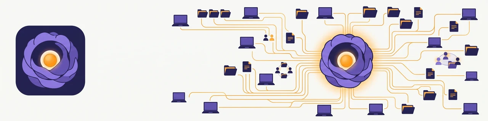
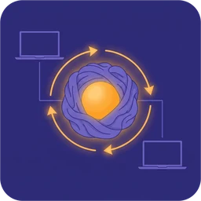
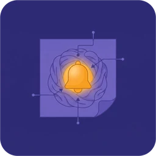

<picture>
  <source media="(prefers-color-scheme: dark)" srcset="docs/assets/banner-dark.webp">
  
</picture>

# corkern

**Collective knowledge for Claude Code — across projects, devices and people.**

Claude Code keeps what it learns about you and your work in per-project memory files on one
machine. corkern turns that into a shared, synced knowledge base: a private git repository that
every machine you use reads from and writes to, so what was learned in one project, on one laptop,
is there the next time — anywhere. Sharing it across a team is the next idea, not yet a tested
feature (see [Why this exists](#why-this-exists)).

> Status: 2.0.0rc3, an early test release on PyPI — published only to try the release process; please
> do not use it yet. A proper version is planned for the coming weeks. See
> [Status and scope](#status-and-scope).

## Install — once per machine

```
uv tool install corkern        # or: pipx install corkern
corkern setup --clone git@github.com:<you>/<your-private-knowledge-repo>.git
corkern signing                # this machine's signing (+ push) key — asks first
corkern init-device --apply    # wire Claude Code — shows the plan, asks first
corkern doctor                 # check the installation
```

First machine without a knowledge repo: `corkern setup --create-github <you>/<name>` creates it as
a **private** GitHub repository (`--new` keeps it local). corkern is installed exactly once per
user, as a tool: a copy inside a project's virtual environment refuses to act, and `corkern
doctor` lists every copy it finds (and a corkern v1 still installed).

## The name

It started as **brain** — too generic. **Cortex** fitted better: the cerebral cortex is the
wrinkled outer layer of the brain that handles high-level thinking, memory, language and sensory
processing. **Core** was next, but "corcore" did not sound right — so the German word for it
came in: **Kern** (core, nucleus, kernel, heart).

**cor**tex + **kern** = **corkern**: the core central memory for all your projects. A layer that
learns to be the glue — carrying knowledge between projects, devices and repositories and holding
them together as one. A reflection of how you think, and a way not to forget.

For a team, it is the team's collected knowledge: collective knowledge.

## Why this exists

I built corkern for myself. As a Claude Code user working on several machines, I wanted Claude's
memory to follow me — and I wanted to control how: in a git repository I own, where every change
is committed, visible and — once the machine has its key — signed. At the time, corkern gave me
that: a controlled possibility.

While building it, I realised the same design could serve a team: one shared knowledge repository,
with every member's machine signing its own contributions. So far that has only been simulated:
10 Docker containers — three teams, one of them with an intruder who can push but is not trusted
(`make test-teams`). corkern has never been used by a real team.

I expect AI providers to offer this themselves, and probably better than corkern does. For Claude
Code there is an open request for exactly this: account-level sync for user config and auto memory
([anthropics/claude-code#87027](https://github.com/anthropics/claude-code/issues/87027)).

I am releasing corkern so that its ideas can be picked up by others, towards a better framework
for AI memory that its users stay in control of. My wish: that Anthropic first, and anyone else
after, takes at least one idea from corkern. That would be nice to see.

## Status and scope

Use corkern at your own risk. I have tried to cover many problematic scenarios — several machines
writing at the same time, two machines changing the same memory, interrupted or failed syncs, an
empty or unreachable remote — and there are certainly others I have missed.

When something does go wrong, this is what corkern does:

- The hooks always exit successfully, so a sync problem does not stop a Claude Code session; it is
  recorded and shown by `corkern status`.
- When two machines change the same memory, both versions are kept
  (`<name>.conflict-<host>-<time>.md`) instead of one overwriting the other.
- Memories leave the machine only through git, to the knowledge repository you configure — and,
  when you run `corkern distill`, to Claude for the analysis.

The scenarios it is tested against (single machine, Docker, two devices, five devices syncing
concurrently, real Claude Code sessions) are listed in [CLAUDE.md](CLAUDE.md).

## What it does

-  **Syncs memories** between machines through a private git repository you own
  (`$CORKERN_MEMORY_DIR`): pulled when a Claude session starts, committed as memories are
  written, pushed when Claude finishes a reply.
-  **Brings context into every session**: open reminders, recent session notes and important
  memories are shown to Claude at session start.
-  **Keeps concurrent edits side by side**: when two machines change the same memory, both versions
  are kept (`<name>.conflict-<host>-<time>.md`) and reported, instead of one overwriting the other.
  Memory indexes and the project registry merge line by line.
-  **Stays out of Claude's way**: sync problems are recorded and shown by `corkern status`; the
  hooks do not block or interrupt a session.
-  **One key per machine**: each machine signs its memory commits with its own key and pushes with
  a deploy key limited to the knowledge repository (`corkern signing`, which asks before creating
  anything and explains the manual route when you decline).
-  **Accepts only what your devices
  signed** (opt-in, `corkern trust`): each machine keeps its own list of trusted device keys.
  Incoming memories signed by any other key, or unsigned, are held back and listed — they do not
  reach Claude's context on that machine until you accept them. Only SSH signatures by a key in
  that machine's own list count: OpenPGP or X.509 signatures are held back too, whatever a GnuPG
  keyring on the machine says, and a device name is shown as verified only when it comes from
  that list.
-  **Keeps secrets out of the
  repository**: before every commit, known token formats, private keys and `password = …`-style
  values in memories are replaced by a marker; the original stays on that machine only
  (`corkern secrets`). Key and `.env` files are ignored by name. The scan is pattern-based: it
  catches the formats it knows, so a secret in an unknown format can still get through.
- **Warns when `MEMORY.md` outgrows what Claude Code loads** (200 lines / 25 KB) — also when the
  extra lines came from another device.
- **Uses Claude Code's own setting** (`autoMemoryDirectory`, via `corkern init-device`) to point
  each project's memory at the knowledge repository.
- **Reads or wires a project folder only once this machine confirmed its path.** The registry
  (`corkern.conf`) is shared, so a teammate can point a project name at any folder. `harvest`,
  `prune`, `graphify`, `crg` and `init-device` use a path only when this machine confirmed it.
  `corkern add` confirms a path, and so do this machine's own `corkern.conf.local`, a per-project
  "y" in `init-device`, and `migrate` for the projects of its own export. A path that changes
  later on another machine is no longer confirmed. `status`, `list` and the session context flag
  such projects; `corkern add <slug> <path>` or `corkern add --confirm-all` (one question, after
  listing every path) confirms them.

## With or without a dotfile manager

corkern works the same whether `~/.claude` and your shell profile are plain files or managed by
yadm, chezmoi, stow or similar. It writes only these, and only what it needs in them:

| File | What corkern adds | The rest of the file |
|---|---|---|
| `~/.claude/settings.json` | one hook each for SessionStart, PostToolUse (Write\|Edit), Stop, SessionEnd | parsed and merged, your other settings and hooks stay; a backup is written first |
| `~/.claude/CLAUDE.md` | one import line, `@~/.corkern/global/CLAUDE.md` | stays as it is |
| `~/.claude/commands/corkern-*.md` | four slash commands (files of their own) | — |
| `<project>/.claude/settings.local.json` | `autoMemoryDirectory` | kept out of the project's git |
| `~/.claude/settings.local.json` (only for a project registered at `~`) | `autoMemoryDirectory` | other keys stay; this machine's own path, so keep it out of shared dotfiles |
| `~/.bashrc` (migration script 2, asks first) | `export PATH="$HOME/.local/bin:$PATH"`, only if missing | appended, nothing else changes |

What it writes there is the same on every machine: paths are written as `$HOME/…` or `~/…`, the
hooks do nothing on a machine without corkern, and the location of this machine's knowledge
repository is not in these files: `corkern setup` records it in this machine's
`~/.config/corkern/machine.conf`. So a shared `settings.json` also works on machines without corkern, or
with another username. A second `corkern init-device` changes nothing. An `autoMemoryDirectory`
that points at another folder is replaced only after a "y" for that project; `--yes` does not
approve that, nor a project whose path this machine has not confirmed. A file that is a symlink
(for example from stow) is not written through; `init-device` says so and leaves it to you.

## Moving from v1

Three scripts in [`migrate/`](migrate/README.md) do it: export on a v1 machine, set up a new
machine from that export, later switch each v1 machine. Each checks its preconditions first,
records its progress (re-run after a problem continues where it stopped) and logs everything;
a rollback script puts v1 back exactly as it was.

## Commands

```
corkern setup | doctor | status | init-device | install-hooks | signing | trust | secrets
corkern list | add | remove | remind | todos | done | sessions | log | get-AIinstructions
corkern graphify | crg | memory-prune | metrics | distill | harvest | refine | prune | iwe
corkern init | migrate | export | import
```

`corkern <command> --help` describes each one.

## Development

See [CLAUDE.md](CLAUDE.md) for the architecture, the coexistence rules with v1 and the test
matrix (`make test`, `make test-docker`, `make test-e2e`, `make test-multi`, `make test-claude`).
What may be published is checked by the release gate ([docs/release-gate.md](docs/release-gate.md)).
Licence: [MIT](LICENSE).

## Artwork

The banners, logos and icons were generated with Google Gemini; the SVG logo and the smallest
favicon sizes are simplified redraws. Details in [docs/assets/CREDITS.md](docs/assets/CREDITS.md).
